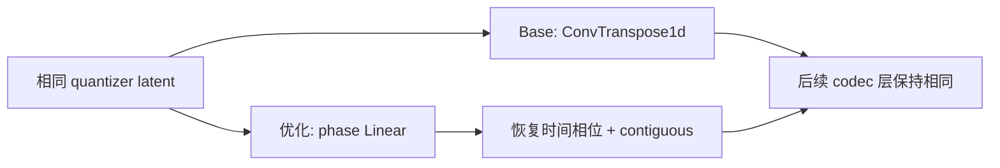

# Fish Audio Drama 3：Quantizer phase projection 上采样

状态：单组服务初筛有高并发收益及低并发/首音回退，待定位和决策，未提 PR。主分类：measured_tradeoff。

[总索引](../../README.md) · [指标与归因口径](../../records/performance-methodology.md) · [代码分支](https://github.com/EddieTzy/sglang-omni/tree/perf/drama3-b200-quantizer-upsample)

## 为什么优化

无重叠转置卷积可能走带布局转换的 cuDNN 路径，存在用等价投影减少冗余工作的机会。基线热点占比尚未由完整服务 profile 证明。

这是优化动机；只有以下实测和 profile 支持的部分才作为已确认瓶颈或收益。

## 优化位置与原理

优化层面：codec 上采样算子与数据布局。

kernel size 等于 stride 时各相位互不重叠，把 [Cin,Cout,stride] 权重按相位重排为 [stride*Cout,Cin]，对每个输入帧做线性投影，再恢复时间相位顺序与连续布局。只在满足条件的 SM100 FP16 channels-last 路径使用，不修改共享 codec。

对输入 x[B,Cin,T]、权重 W[Cin,Cout,s]、无 padding 且 kernel=stride=s 的转置卷积：

```text
y[b,o,t*s+p] = bias[o] + sum_c x[b,c,t] * W[c,o,p]
W_phase[p*Cout+o,c] = W[c,o,p]
```

每个输出相位只依赖一个输入帧，因此可以将 W_phase 用作线性层权重。投影得到 [B,T,s*Cout]，先按时间和相位恢复 [B,T*s,Cout]，再转置并 contiguous 成 [B,Cout,T*s]。bias 按相位重复；原卷积权重只在构建时重排一次。FP16 中算法与累加顺序可产生差异，数学等价不代表完整波形逐位相同。



启用条件：SM100、FP16、kernel=stride、groups=1、dilation=1、padding=0、output_padding=0。不满足条件保留原模块；只为 ChannelsLastDecoder 构建新的上采样序列，不改共享 codec。增加的开销是重排权重存储、线性投影后的连续布局拷贝；是否抵消卷积路径开销必须按形状实测。

实现说明：仅在 B200 FP16、kernel=stride 等条件满足时以 phase-ordered dense projection 替代 quantizer 转置卷积；不改写共享 codec 模块。

代码位置：

- sglang_omni/models/fishaudio_drama3/channels_last_decoder.py：PhaseLinearUpsample, ChannelsLastDecoder.__init__, ChannelsLastDecoder.__call__

## 基线与复现条件

基线：f17a438cd753248d70916700aa4dccd9e7feb098

当前验证运行时：torch 2.14.1+cu130、sglang 0.5.23、triton 3.8.0、flashinfer-python 0.7.2、driver 580.173.02。设备为 B200；语料、采样、预热和重复次数见下方已有记录。原始资料缺少的字段标为待补，不跨设备、分支或运行版本合并收益。代码已推送不表示 PR 已提交。

## Base 与优化后 profile

已采集真实 codec 权重的共享 GPU 局部算子轨迹；完整服务独占 profile 已完成，见[服务归因报告](profiles/service-20261118/README.md)。见 [profile 记录](profiles/README.md)。局部 batch 不是客户端并发，不能据此推断服务调度或首包长尾。

后续逐项对照服务阶段关键路径、CPU/CUDA 同步、动态 batch/形状、kernel、内存拷贝和空闲区间。明确 cold/warm 与 profiler 开销，并保留反例。

## 性能：RTF、cost 与首包

已从现有独占 B200 原始数据补齐 RTF、每请求 cost、首包与吞吐。见 [性能报告](../../records/drama3-quantizer-b200-20261118.md) 和 [结构化指标](metrics/serving.json)。

已有结论：B200 单组 base→优化初筛：并发1/16/64 音频吞吐 -5.75%/+3.77%/+11.10%；首音 p95 在并发1/16 变慢、64 变快。不是全场景提升，也不是无收益。

## 正确性、质量与既有详细记录

将满足条件的 FP16 quantizer 转置卷积表达为 phase-ordered dense projection：仅适用于 SM100、无分组、无 dilation、无 padding、无 output padding，且 kernel size 等于 stride。优化只作用于 channels-last 解码器的路径，不替换共享 codec 内的模块，避免影响 incremental / stateful 解码器。

最终实际生效路径通过 30 项正确性检查，其中 13 项为 CUDA 检查；覆盖输出采样位置、bias、非连续输入、适用条件、投影 CUDA Graph 与 eager 的逐位一致性，以及共享 codec 的 stateful 使用。

真实 checkpoint 的 16 组 EN/ZH 固定码本对照确认选中 2 个投影，输出长度保持一致，均通过既有 FP16 codec 容差（rtol=0.02、atol=0.02）；最大波形绝对差为 0.00323486328125，最低波形 SNR 为 53.2953 dB。这是数值与重构检查，不是听感、ASR、音色相似度或质量非劣效结论。

一组独占 B200 的服务性能对照已完成，顺序为 base→优化：并发1/16/64 分别测 64/512/1088 个请求，每臂先预热，未追加重复。全部 3328 个正式请求成功、观察到正常 stop、无生成预算截断。音频吞吐变化分别为 -5.75%/+3.77%/+11.10%，首音 p95 在并发1/16 变慢、64 变快。完整条件和数据见[单组实测报告](../../records/drama3-quantizer-b200-20261118.md)。

离线配对发现：并发1 的 64 条请求逐条 completion token 数都一致，首音中位数从 72.5 ms 变为 74.2 ms，但 3 条早期请求分别多等待约 0.40/0.81/1.18 s；它们贡献了约 93.5% 的首音增加总量。尚不能将退化归因为 GEMM 每一步更慢，也不能剔除这些样本美化结果。下一步是定位首次路径和调度等因素，再决定是否限制启用条件；后续用户已授权独占诊断，相关进度另见 profile 记录。

## 完整服务 profile 与后续诊断

[独占服务归因报告](profiles/service-20261118/README.md)记录 base 热点、替换后 kernel、GPU 活动并集、首包阶段边界、无 profiler 的短控制、失败采样与恢复。观测支持算子/布局路径优化，没有证明调度气泡减少。短控制 C1 基本持平、C64 有约2.52%吞吐正向变化但首包尾延迟回退，不能覆盖此前正式初筛。

## 归因边界与决定

已观测指标、代码机制和未证实的因果分别记录。当前分类和已有记录中的取舍继续有效；没有 profile 或质量证据时不写成已解决。

## 来源与后续工作

移植、主线适配与验证；原始优化来自 lamianlbe，保留归属，不计为本人原创

补齐尚缺的精确复现字段、前后 profile、逐请求 RTF/cost/首包及质量证据后，再判断是否推进 PR；无收益和回退实验同样保留。
